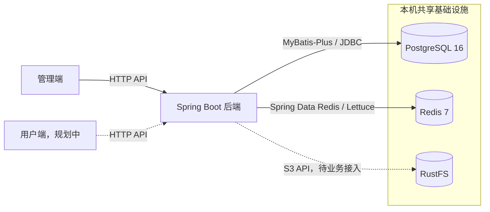

# Hoshi 项目概览

## 项目定位

Hoshi 是个人独立开发、长期维护、面向真实用户的类 QQ 网页聊天项目。先建设能够维护用户与群组的管理端，再开发用户端。普通用户自行注册。管理员使用独立后台账号，由维护者通过数据库操作开通。

接口契约、表结构、登录方案和实时通信选型随对应模块的设计与开发确定。

## 技术选型

### 后端与数据

- **Java 21、Spring Boot 4.1.2、Maven Wrapper**。管理端和用户端由同一个 Spring Boot 应用承载。Spring MVC 负责 HTTP，Bean Validation 负责输入校验，Spring Security 提供认证与授权基础。Springdoc 生成 OpenAPI 文档，Lombok 通过编译期注解处理接入。 [Spring Boot 系统要求](https://docs.spring.io/spring-boot/system-requirements.html) · [Springdoc](https://springdoc.org/)
- **PostgreSQL、MyBatis-Plus、Flyway**。MyBatis-Plus 与 PostgreSQL JDBC 驱动负责数据访问，Flyway 在应用启动时执行版本化 SQL。表结构、约束和索引由迁移定义。 [MyBatis-Plus 安装指南](https://baomidou.com/en/getting-started/install/) · [Spring Boot 的 Flyway 集成](https://docs.spring.io/spring-boot/how-to/data-initialization.html)
- **Redis 与对象存储**。本地复用共享 Redis 7，使用 Spring Data Redis 和 Lettuce。对象存储使用 S3 接口，本地复用共享 RustFS，客户端随业务接入。 [Spring Data Redis 配置](https://docs.spring.io/spring-boot/reference/data/nosql.html#data.nosql.redis) · [RustFS S3 接口](https://docs.rustfs.com/en/administration/protocols/s3)

### 前端

- **pnpm workspace、React、TypeScript、Vite、React Router**。当前 workspace 包含管理端和共享请求包。用户端接入后与管理端各自构建。Vite 提供开发服务器和构建能力，React Router 使用 Declarative 模式管理页面、布局与导航。 [pnpm Workspace](https://pnpm.io/workspaces) · [Vite 文档](https://vite.dev/guide/) · [React Router 模式](https://reactrouter.com/start/modes)
- **Axios、TanStack Query、Zustand、Zod**。Axios 负责 HTTP 请求。TanStack Query 管理服务端数据的查询、变更请求和缓存，Zustand 管理跨页面共享的客户端状态，Zod 在外部数据进入前端时做运行时校验。 [Axios 文档](https://axios-http.com/docs/intro) · [TanStack Query 文档](https://tanstack.com/query/latest/docs/framework/react/overview) · [Zustand 文档](https://github.com/pmndrs/zustand) · [Zod 文档](https://zod.dev/)
- **Ant Design、Tailwind CSS**。管理端采用 Ant Design，表单状态由 Ant Design Form 管理。用户端计划用 Tailwind CSS 组织聊天界面样式。 [Ant Design 文档](https://ant.design/docs/react/introduce/) · [Tailwind CSS 的 Vite 集成](https://tailwindcss.com/docs/installation/using-vite)

## 模块拓扑

## 仓库组织

单仓库统一维护文档、后端和前端。后端按业务划分 Maven 模块，由 `hoshi-app` 装配并部署为一个可执行 JAR。业务模块通过公开的用例或读取接口协作。前端用 pnpm workspace 管理应用和共用包。 [Maven 多模块构建](https://maven.apache.org/guides/mini/guide-multiple-modules.html) · [pnpm Workspace](https://pnpm.io/workspaces)

| 路径 | 职责 |
| --- | --- |
| `backend/` | Maven 父工程 `hoshi-parent`，聚合子模块并管理依赖版本 |
| `backend/hoshi-app/` | 启动类、运行配置和 Flyway 迁移资源 |
| `backend/hoshi-common/` | 统一响应、业务错误、MVC 全局异常处理、分页契约和共用 MyBatis-Plus 配置 |
| `backend/hoshi-user/` | 用户账号、资料及所属的数据访问 |
| `backend/hoshi-auth/` | 登录、认证会话及 Spring Security 相关能力 |
| `frontend/` | pnpm workspace 根目录 |
| `frontend/apps/admin/` | 独立构建的管理端应用 |
| `frontend/apps/web/` | 用户端规划目录，接入后独立构建 |
| `frontend/packages/` | 两端出现实际复用时提取的公共包 |
| `frontend/packages/api-client/` | Axios 请求、响应校验和错误类型，当前供管理端使用 |
| `docs/` | 项目概览、工程指南等长期文档 |

共享服务的配置与数据库约定见 [工程指南](05-engineering-guide.md)。

## API 约定

- JSON 业务响应包含 `data`、`code`、`message`、`errors`。HTTP 状态码反映操作结果，成功码为 `SUCCESS`，无数据的成功响应和错误响应使用 `data: null`。`errors` 在字段校验失败时包含 `field` 和 `message`，没有字段明细时为 `[]`。 [全局错误码](04-api-design/00-error-codes.md)
- 管理端页码列表使用查询参数 `page` 和 `pageSize`，默认值分别为 `1` 和 `20`，页大小上限为 `100`。空值、非整数和超出范围的值返回 `400 / INVALID_ARGUMENT`。响应 `data` 包含数组 `items`、总条数 `total` 和实际使用的 `page`、`pageSize`。列表为空时 `items` 为 `[]`。仓储使用相同筛选条件计算总数，再按唯一、稳定的顺序读取当前页。 [PostgreSQL 16 LIMIT 和 OFFSET](https://www.postgresql.org/docs/16/queries-limit.html)

## 前端请求约定

- 管理端通过 `@hoshi/api-client` 的 `createRequest` 创建请求实例，用户端接入时创建自己的实例。业务接口使用 `request<T>({ method: "GET", url, params, signal })`。`url` 相对于实例的 API 基址，成功返回业务 `data`，无数据的成功响应使用 `request<null>`。共享包校验 `data`、`code` 和 `message`，接口可传入 Zod `schema` 进一步校验数据。 [Axios 实例](https://axios.rest/pages/advanced/create-an-instance) · [Zod Schema](https://zod.dev/api)
- 请求失败通过 `RequestError` 提供失败类型，并在适用时保留 HTTP 状态、业务码和公开消息。管理端使用 TanStack Query 的缓存级回调统一提示首次查询和提交失败。取消与已有数据的后台刷新失败保持安静。表单设置 `meta: { errorFeedback: "local" }` 后可自行展示字段反馈。 [QueryCache](https://tanstack.com/query/latest/docs/reference/QueryCache) · [MutationCache](https://tanstack.com/query/latest/docs/reference/MutationCache)
- 查询函数将 TanStack Query 提供的 `signal` 传给 `request`。管理端查询在网络错误、超时或 HTTP `5xx` 时最多重试一次，提交默认执行一次。缓存键、时效和失效由所属业务模块管理。 [查询取消](https://tanstack.com/query/latest/docs/framework/react/guides/query-cancellation) · [查询重试](https://tanstack.com/query/latest/docs/framework/react/guides/query-retries)
