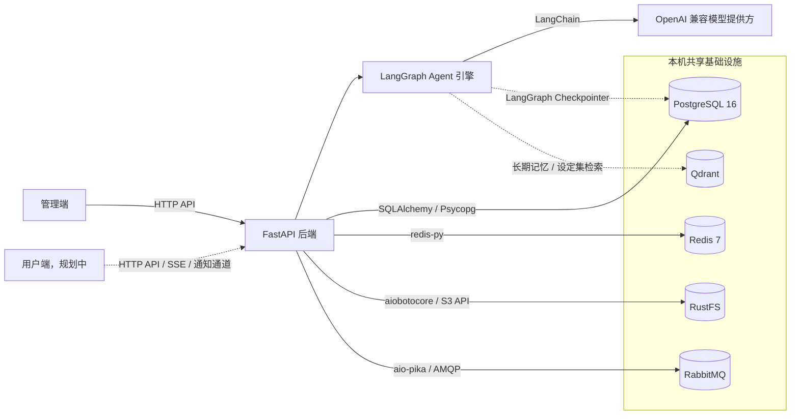

# Hoshi 项目概览

## 项目定位

Hoshi 是个人独立开发、长期维护、面向真实用户的多角色 AI 聊天陪伴 Agent 平台。保留用户与管理员双账号体系：先建设管理平台角色、模型配置与用户的管理端能力，再建设面向普通用户的 AI 陪伴用户端。普通用户自行注册后，可与平台预设或自定义的 AI 角色展开具备人设一致性、长期记忆、情绪/关系状态演化、工具调用及主动关怀能力的长期陪伴对话；管理员使用独立后台账号，由维护者通过数据库操作开通。

系统在架构上保持高度可扩展性，将消息载体、模型接入与工具注册从核心图编排中解耦，以便后续平滑扩展语音对话（ASR/TTS）、图像/视觉多模态及外部能力插件。

接口契约、表结构及具体工作流节点随对应模块的设计与开发逐步确认并归档。

## 技术选型

### 后端、AI 编排与数据

- **Python 3.12、FastAPI、Pydantic、Uvicorn**。一个 FastAPI 应用承载管理端与用户端的 HTTP 接口及 SSE 流式对话接口。Pydantic 定义请求和响应契约，FastAPI 从路由和契约生成 OpenAPI，Uvicorn 运行 ASGI 应用。uv 锁定依赖，Ruff 检查代码和格式。 [FastAPI 响应模型](https://fastapi.tiangolo.com/tutorial/response-model/) · [uv 锁定与同步](https://docs.astral.sh/uv/concepts/projects/sync/)
- **LangChain 与 LangGraph**。LangChain 提供 OpenAI 兼容多模型接入（支持按场景配置对话模型与 Embedding 模型）、统一消息内容块与工具调用抽象；LangGraph 编排有状态的陪伴对话工作流、情绪/关系状态流转与工具决策循环，并复用 PostgreSQL 16 作为 Checkpointer 持久化图运行状态与短期工作记忆。 [LangChain 文档](https://python.langchain.com/docs/introduction/) · [LangGraph 文档](https://langchain-ai.github.io/langgraph/)
- **Qdrant 向量数据库**。本地复用共享 Qdrant 服务，按 `user_id`、`character_id` 与记忆类型隔离存储对话提炼出的长期情景记忆、用户事实与角色设定集（Lore），结合语义相似度与时间衰减进行召回。 [Qdrant 文档](https://qdrant.tech/documentation/)
- **PostgreSQL 16、SQLAlchemy、Psycopg 3、Alembic**。SQLAlchemy 异步 ORM 与 Psycopg 负责业务关系数据（账号、会话、角色配置、展示消息、关系状态等）访问，Alembic 通过独立命令执行版本化迁移。表结构、约束和索引由迁移定义。 [SQLAlchemy 异步 ORM](https://docs.sqlalchemy.org/en/21/orm/extensions/asyncio.html) · [Alembic 迁移](https://alembic.sqlalchemy.org/en/latest/tutorial.html)
- **Redis、对象存储与消息队列**。本地复用共享 Redis 7、RustFS 与 RabbitMQ。FastAPI 在应用生命周期内管理异步 redis-py 客户端与 `aiobotocore` S3 异步客户端：Redis 用于登录限流、流式控制锁与主动关怀防打扰冷却；RustFS 采用私有桶/公开桶双桶隔离，Web 通过私有桶适配器提供直传预签名、私有读取签名与对象元信息维护；异步文件加工、记忆提炼与主动关怀等后台任务按需通过消息队列或调度器解耦执行。 [redis-py 异步客户端](https://redis.io/docs/latest/develop/clients/redis-py/async/) · [RustFS S3 接口](https://docs.rustfs.com/en/administration/protocols/s3) · [aiobotocore](https://aiobotocore.aio-libs.org/en/stable/tutorial.html)

### 实时通信

- **HTTP + SSE 流式对话与独立通知通道**。用户端 AI 回复采用 `POST` + SSE（Server-Sent Events）流式返回 LangGraph 节点状态、文本分片与可扩展内容块；主动关怀等服务端异步推送消息通过独立实时通知通道或按需引入 WebSocket 承载。

### 前端

- **pnpm workspace、React、TypeScript、Vite、React Router**。当前 workspace 包含管理端和共享请求包。用户端接入后与管理端各自构建。Vite 提供开发服务器和构建能力，React Router 使用 Declarative 模式管理页面、布局与导航。 [pnpm Workspace](https://pnpm.io/workspaces) · [Vite 文档](https://vite.dev/guide/) · [React Router 模式](https://reactrouter.com/start/modes)
- **Axios、TanStack Query、Zustand、Zod**。Axios 负责 HTTP 请求。TanStack Query 管理服务端数据的查询、变更请求和缓存，Zustand 管理跨页面共享的客户端状态，Zod 在外部数据进入前端时做运行时校验。 [Axios 文档](https://axios-http.com/docs/intro) · [TanStack Query 文档](https://tanstack.com/query/latest/docs/framework/react/overview) · [Zustand 文档](https://github.com/pmndrs/zustand) · [Zod 文档](https://zod.dev/)
- **Ant Design、Tailwind CSS**。管理端采用 Ant Design，表单状态由 Ant Design Form 管理。用户端计划用 Tailwind CSS 组织 AI 陪伴对话与角色管理界面样式。 [Ant Design 文档](https://ant.design/docs/react/introduce/) · [Tailwind CSS 的 Vite 集成](https://tailwindcss.com/docs/installation/using-vite)

## 模块拓扑

## 仓库组织

单仓库统一维护文档、后端和前端。后端按业务模块组织，由应用工厂装配成一个 FastAPI 应用。每个业务模块组织自己的路由、输入输出模型、用例、ORM 模型和查询。路由调用用例，仓储负责所属模块的持久化，跨模块通过公开的用例或读取接口协作。前端用 pnpm workspace 管理应用和共用包。 [FastAPI 多模块应用](https://fastapi.tiangolo.com/tutorial/bigger-applications/) · [pnpm Workspace](https://pnpm.io/workspaces)

| 路径 | 职责 |
| --- | --- |
| `backend/` | Python 项目、uv 锁文件、Ruff 和 Alembic 配置 |
| `backend/src/hoshi/main.py` | FastAPI 应用工厂与进程内资源生命周期 |
| `backend/src/hoshi/core/` | 应用配置和数据源连接配置 |
| `backend/src/hoshi/api/` | FastAPI 集成、全局异常处理和请求依赖 |
| `backend/src/hoshi/db/` | SQLAlchemy 声明式基类、引擎和会话工厂 |
| `backend/src/hoshi/infra/` | 外部基础设施客户端工厂（如 `aiobotocore` S3 客户端与 `aio-pika` RabbitMQ 发布器） |
| `backend/src/hoshi/workers/` | 独立后台 Worker 启动入口（如文件校验、规格生成、删源与分钟维护循环） |
| `backend/src/hoshi/shared/http/` | 各业务模块共享的 HTTP 响应、错误码、业务异常和分页契约 |
| `backend/src/hoshi/shared/utils/` | 各业务模块实际复用的通用工具 |
| `backend/src/hoshi/modules/` | 随功能接入建立的业务模块 |
| `backend/migrations/` | Alembic 迁移环境及修订文件 |
| `frontend/` | pnpm workspace 根目录 |
| `frontend/apps/admin/` | 独立构建的管理端应用 |
| `frontend/apps/web/` | AI 陪伴用户端规划目录，接入后独立构建 |
| `frontend/packages/` | 两端出现实际复用时提取的公共包 |
| `frontend/packages/api-client/` | Axios 请求、响应校验和错误类型，当前供管理端使用 |
| `docs/` | 项目概览、工程指南等长期文档 |

共享服务的配置与数据库约定见 [工程指南](05-engineering-guide.md)。

## API 约定

- 业务路由使用 `/api/v1` 前缀。JSON 业务响应包含 `data`、`code`、`message`、`errors`。HTTP 状态码反映操作结果，成功码为 `SUCCESS`，无数据的成功响应和错误响应使用 `data: null`。`errors` 在字段校验失败时包含 `field` 和 `message`，没有字段明细时为 `[]`。 [全局错误码](04-api-design/00-error-codes.md)
- 管理端受保护业务路由统一注册到 `hoshi.api.v1.admin` 的 `protected_admin_api`，通过 `auth` 模块的 `require_admin_account` 依赖在进程内完成 Bearer 访问令牌验签与 `AccountType.ADMIN` 入口检查，不访问数据库或 Redis；需要校验实时账号状态或读取最新资料的接口（如 `GET /api/v1/admin/accounts/me`）由所属业务用例显式查询数据库。
- 管理端页码列表使用查询参数 `page` 和 `pageSize`，默认值分别为 `1` 和 `20`，页大小上限为 `100`。路由通过 `PageParams` 绑定 `fastapi-pagination` 的分页参数模型。空值、非整数和超出范围的值返回 `400 / INVALID_ARGUMENT`。响应 `data` 使用 `PageResult[T]`，包含数组 `items`、总条数 `total` 和实际使用的 `page`、`pageSize`。列表为空时 `items` 为 `[]`。仓储为查询指定唯一、稳定的排序，在用例事务内将分页参数显式传给 SQLAlchemy 集成的 `apaginate`。分页库基于该查询计算总数并读取当前页。 [fastapi-pagination SQLAlchemy 集成](https://uriyyo-fastapi-pagination.netlify.app/integrations/sqlalchemy/paginate/) · [PostgreSQL 16 LIMIT 和 OFFSET](https://www.postgresql.org/docs/16/queries-limit.html)

## 前端请求约定

- 管理端通过 `@hoshi/api-client` 的 `createRequest` 创建请求实例，用户端接入时创建自己的实例。业务接口使用 `request<T>({ method: "GET", url, params, signal })`。`url` 相对于实例的 API 基址，成功返回业务 `data`，无数据的成功响应使用 `request<null>`。共享包校验 `data`、`code` 和 `message`，接口可传入 Zod `schema` 进一步校验数据。 [Axios 实例](https://axios.rest/pages/advanced/create-an-instance) · [Zod Schema](https://zod.dev/api)
- 请求失败通过 `RequestError` 提供失败类型，并在适用时保留 HTTP 状态、业务码和公开消息。管理端使用 TanStack Query 的缓存级回调统一提示首次查询和提交失败。取消与已有数据的后台刷新失败保持安静。表单设置 `meta: { errorFeedback: "local" }` 后可自行展示字段反馈。 [QueryCache](https://tanstack.com/query/latest/docs/reference/QueryCache) · [MutationCache](https://tanstack.com/query/latest/docs/reference/MutationCache)
- 查询函数将 TanStack Query 提供的 `signal` 传给 `request`。管理端查询在网络错误、超时或 HTTP `5xx` 时最多重试一次，提交默认执行一次。缓存键、时效和失效由所属业务模块管理。 [查询取消](https://tanstack.com/query/latest/docs/framework/react/guides/query-cancellation) · [查询重试](https://tanstack.com/query/latest/docs/framework/react/guides/query-retries)
