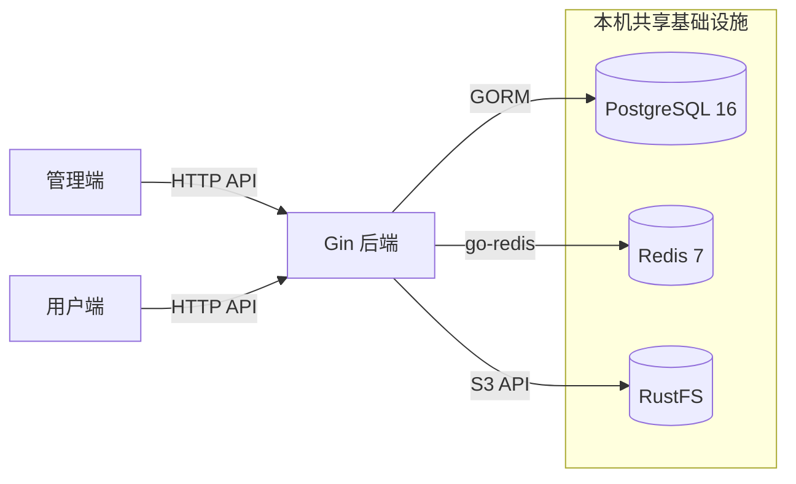

# Hoshi 项目概览

## 项目定位

Hoshi 是个人独立开发、长期维护、面向真实用户的类 QQ 网页聊天项目。先建设能够维护用户与群组的管理端，再开发用户端。普通用户自行注册。管理员使用独立后台账号，由维护者通过数据库操作开通。

接口契约、表结构、登录方案和实时通信选型随对应模块的设计与开发确定。

## 技术选型

### 后端与数据

- **Go、Gin、GORM、PostgreSQL**。Gin 提供 HTTP 路由、中间件和请求绑定，GORM 负责运行时数据访问，PostgreSQL 保存业务持久数据。后端以一个 Go 服务承载管理端和用户端的业务模块。Mattermost 的 Go 服务和 PostgreSQL 存储是同类项目的参考。 [Gin 文档](https://gin-gonic.com/en/docs/) · [GORM 数据库连接指南](https://gorm.io/docs/connecting_to_the_database.html) · [Mattermost 应用架构](https://docs.mattermost.com/deployment-guide/application-architecture)
- **Goose**。将版本化 SQL 纳入仓库，由 Goose 按顺序执行。表结构、约束和索引以迁移 SQL 为准，数据库变更随代码审阅。应用启动时禁用 GORM `AutoMigrate`。 [GORM 迁移指南](https://gorm.io/docs/migration.html) · [Goose 文档](https://pressly.github.io/goose/)
- **Redis 与对象存储**。本地复用共享 Redis 7，Go 客户端采用 `go-redis`，具体用途随模块确认。对象存储通过 AWS SDK for Go v2 的 S3 客户端接入，便于应用沿用 S3 接口。本地使用共享 RustFS，线上对象存储根据部署条件选定。 [go-redis 官方指南](https://redis.io/docs/latest/develop/clients/go/) · [RustFS S3 接口](https://docs.rustfs.com/en/administration/protocols/s3) · [AWS SDK for Go v2](https://docs.aws.amazon.com/sdk-for-go/v2/developer-guide/go_s3_code_examples.html)

### 前端

- **pnpm workspace、React、TypeScript、Vite、React Router**。两端由同一 workspace 管理依赖，各自构建。Vite 提供开发服务器和构建能力，React Router 使用 Declarative 模式管理页面、布局与导航。 [pnpm Workspace](https://pnpm.io/workspaces) · [Vite 文档](https://vite.dev/guide/) · [React Router 模式](https://reactrouter.com/start/modes)
- **Axios、TanStack Query、Zustand、Zod**。Axios 负责 HTTP 请求。TanStack Query 管理服务端数据的查询、变更请求和缓存，Zustand 管理跨页面共享的客户端状态，Zod 在外部数据进入前端时做运行时校验。 [Axios 文档](https://axios-http.com/docs/intro) · [TanStack Query 文档](https://tanstack.com/query/latest/docs/framework/react/overview) · [Zustand 文档](https://github.com/pmndrs/zustand) · [Zod 文档](https://zod.dev/)
- **Ant Design、Tailwind CSS**。管理端复用 Ant Design 的表格、表单和交互组件，表单状态由 Ant Design Form 管理。用户端用 Tailwind CSS 组织聊天界面样式。 [Ant Design 文档](https://ant.design/docs/react/introduce/) · [Tailwind CSS 的 Vite 集成](https://tailwindcss.com/docs/installation/using-vite)

## 模块拓扑

## 仓库组织

单仓库统一维护文档、后端和前端。后端用 Go 的 `cmd` 和 `internal` 组织服务入口与业务代码，前端用 pnpm workspace 管理两个应用和实际复用的包。 [Go 模块目录指南](https://go.dev/doc/modules/layout) · [pnpm Workspace](https://pnpm.io/workspaces)

| 路径 | 职责 |
| --- | --- |
| `backend/` | Go 模块根目录 |
| `backend/cmd/server/` | 后端服务入口 |
| `backend/internal/` | 后端内部包，启动、配置、HTTP 和 PostgreSQL 各自负责对应职责，业务逻辑按模块组织 |
| `backend/migrations/` | Goose 执行的版本化 SQL 迁移 |
| `frontend/` | pnpm workspace 根目录 |
| `frontend/apps/admin/` | 独立构建的管理端应用 |
| `frontend/apps/web/` | 独立构建的用户端应用 |
| `frontend/packages/` | 两端出现实际复用时提取的公共包 |
| `frontend/packages/api-client/` | 两端共用的 Axios 请求、响应校验和错误类型 |
| `docs/` | 项目概览、工程指南等长期文档 |

共享服务的配置与数据库约定见 [工程指南](05-engineering-guide.md)。

## API 约定

- JSON 业务响应使用 `data`、`code` 和 `message`，HTTP 状态码反映操作结果。`code` 是供客户端判断的稳定字符串，成功为 `SUCCESS`。`message` 是公开提示文案。无数据的成功响应和错误响应均使用 `data: null`。 [全局错误码](04-api-design/00-error-codes.md)
- 管理端页码列表使用查询参数 `page` 和 `pageSize`，默认值分别为 `1` 和 `20`，页大小上限为 `100`。空值、非整数和超出范围的值返回 `400 / INVALID_ARGUMENT`。响应 `data` 包含数组 `items`、总条数 `total` 和实际使用的 `page`、`pageSize`。列表为空时 `items` 为 `[]`。仓储使用相同筛选条件计算总数，再按唯一、稳定的顺序读取当前页。 [PostgreSQL 16 LIMIT 和 OFFSET](https://www.postgresql.org/docs/16/queries-limit.html)

## 前端请求约定

- 管理端和用户端分别通过 `@hoshi/api-client` 的 `createRequest` 创建请求实例。业务接口使用 `request<T>({ method: "GET", url, params, signal })`。`url` 相对于实例的 API 基址，成功返回业务 `data`，无数据的成功响应使用 `request<null>`。共享包校验统一响应结构，接口可传入 Zod `schema` 进一步校验数据。 [Axios 实例](https://axios.rest/pages/advanced/create-an-instance) · [Zod Schema](https://zod.dev/api)
- 请求失败通过 `RequestError` 提供失败类型，并在适用时保留 HTTP 状态、业务码和公开消息。管理端使用 TanStack Query 的缓存级回调统一提示首次查询和提交失败。取消与已有数据的后台刷新失败保持安静。表单设置 `meta: { errorFeedback: "local" }` 后可自行展示字段反馈。 [QueryCache](https://tanstack.com/query/latest/docs/reference/QueryCache) · [MutationCache](https://tanstack.com/query/latest/docs/reference/MutationCache)
- 查询函数将 TanStack Query 提供的 `signal` 传给 `request`。管理端查询在网络错误、超时或 HTTP `5xx` 时最多重试一次，提交默认执行一次。缓存键、时效和失效由所属业务模块管理。 [查询取消](https://tanstack.com/query/latest/docs/framework/react/guides/query-cancellation) · [查询重试](https://tanstack.com/query/latest/docs/framework/react/guides/query-retries)
