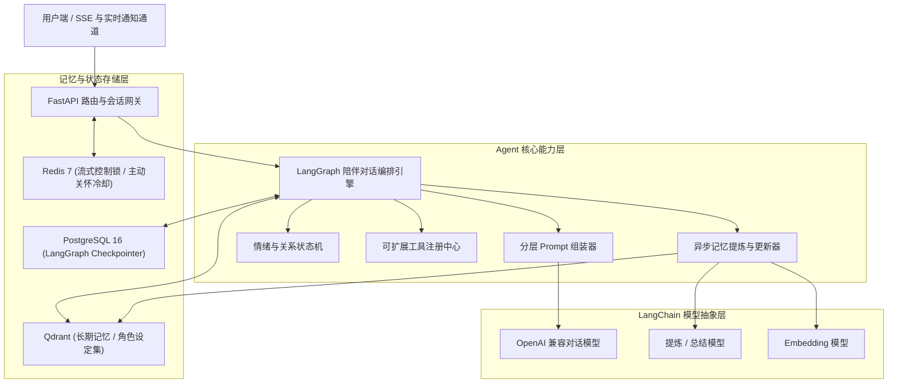
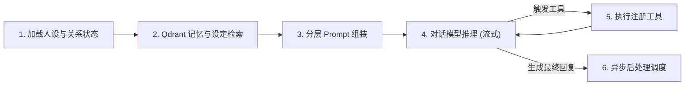

# Hoshi AI 陪伴 Agent 架构设计

本文档定义 Hoshi 在 **LangChain + LangGraph + Qdrant** 技术栈下的总体 AI 分层架构、状态流转、记忆机制及可扩展边界。具体模型表结构、配置参数与接口契约随对应业务模块落地时再行细化归档。

## 1. 总体分层架构

## 2. LangGraph 陪伴对话编排设计

### 2.1 状态模型核心要素
LangGraph 图状态（GraphState）围绕单次会话线程（`thread_id`）维护以下核心信息：
- **消息序列**：采用结构化内容块（Content Blocks）承载对话历史，当前以文本与工具消息为主，结构上兼容图像、音频等后续多模态块。
- **角色与用户上下文**：`user_id`、`character_id`、角色基础人设模板及当前会话元信息。
- **动态陪伴状态**：当前角色情绪标签、好感度/关系阶段及近期状态摘要。
- **检索注入上下文**：本轮从 Qdrant 召回的长期情景记忆、用户事实与角色设定集（Lore）片段。
- **运行控制标识**：用于流式事件输出与工具循环次数限制的边界控制。

### 2.2 核心对话流转路径

1. **加载人设与关系状态**：结合 LangGraph Checkpointer 恢复短期工作记忆，读取角色设定与当前情绪/关系状态。
2. **记忆与设定检索**：基于最新用户输入与近期上下文向量，向 Qdrant 发起带隔离过滤的检索，获取高相关性记忆与角色背景设定。
3. **分层 Prompt 组装**：按固定优先级拼接系统指令、角色人设、关系与情绪状态、召回记忆片段及短期对话窗口。
4. **推理与工具循环**：通过 LangChain 调用 OpenAI 兼容对话模型，以 SSE 向上游输出节点事件与文本分片；若模型发起工具调用，则进入受控工具节点执行后回流推理。
5. **异步后处理调度**：主回复流结束后，异步触发情绪/关系评估更新与长期记忆提炼写入，不阻塞当前对话首字延迟（TTFT）。

## 3. 分层记忆与存储职责

| 存储组件 | 承载内容 | 隔离与管理方式 |
| --- | --- | --- |
| **PostgreSQL 16（业务表）** | 账号、角色配置、会话列表、展示用聊天消息记录、关系与好感度主数据 | SQLAlchemy + Alembic 版本化管理 |
| **PostgreSQL 16（Checkpointer）** | LangGraph 运行时图状态快照与短期工作记忆 | 使用 `langgraph-checkpoint-postgres`，按 `thread_id` 隔离 |
| **Qdrant** | 长期情景记忆（`episodic`）、用户画像事实（`semantic`）、角色设定集（`lore`） | 通过 Payload 强制过滤 `user_id`、`character_id` 与 `memory_type` |
| **Redis 7** | 流式生成防重入锁、中断信号标记、主动关怀触发冷却与频率限制 | 使用统一键前缀 `hoshi:`，设置明确过期时间 |

### 3.1 长期记忆提炼与召回策略
- **异步提炼与去重**：对话达到一定轮次或会话静默后，后台任务调用轻量模型提取关键用户事实与情感事件，经语义相似度比对完成新增、合并或覆盖，避免重复记忆膨胀。
- **混合打分召回**：检索 Qdrant 时在业务层结合向量语义相似度、记忆重要度权重与时间衰减因子进行综合排序，确保“近期发生”与“长期核心记忆”兼顾。

## 4. 主动关怀与实时通道机制

- **触发来源**：后台调度器或延迟任务基于用户最后活跃时间、特定记忆事件（如纪念日/约定提醒）及角色作息配置，判定是否生成主动关怀消息。
- **防打扰守卫**：生成前校验用户全局免打扰设置与 Redis 冷却窗口，避免连续或非预期时段打扰。
- **消息投递**：生成的主动消息写入业务消息表并同步更新会话上下文；用户在线时通过独立实时通知通道推送，离线时等待用户回访拉取。

## 5. 模型接入与 Prompt 分层规范

### 5.1 OpenAI 兼容多模型路由
- 通过 LangChain 统一接口接入任何遵循 OpenAI 协议的云端或本地推理服务（如 OpenAI、DeepSeek、Qwen、Ollama/vLLM）。
- 按能力职责解耦模型配置，支持独立替换与降级：
  - **主对话模型**：负责角色扮演、共情回复与工具决策。
  - **后台轻量模型**：负责记忆提炼、对话摘要与情绪/关系评估。
  - **Embedding 模型**：负责对话文本与设定集向量化（与 Qdrant 集合维度严格绑定）。

### 5.2 Prompt 分层拼接顺序
1. **系统基线层**：安全约束、防越狱护栏、结构化输出/工具使用规范。
2. **角色人设层**：性格特征、背景故事、语言习惯、禁止 OOC（脱离人设）约束。
3. **动态状态层**：当前时间、与用户的关系阶段、好感度与实时情绪状态。
4. **长期记忆与设定层**：本轮从 Qdrant 召回的用户事实、情景记忆与相关设定集。
5. **短期对话窗口**：LangGraph 状态中保留的近期消息序列。

## 6. 高度可扩展性预留边界

为支撑后续能力演进而不重构核心编排图，各层遵循以下解耦约定：
- **多模态消息扩展**：前后端流式事件与 LangGraph 消息体统一采用“内容块（Content Blocks）”结构，后续接入视觉理解（Image Input）、文生图或语音对话（ASR/TTS）时，仅扩展块类型与外围编解码适配器。
- **工具能力插件化**：所有外部工具基于 LangChain 标准 Tool 契约实现并在注册中心统一声明元数据与权限级别，角色配置仅引用工具标识，不与具体工具实现耦合。
- **检索与重排序可插拔**：Qdrant 检索入口封装为独立 Retriever 接口，支持未来按需升级混合检索（稀疏向量 + 稠密向量）或交叉编码重排序（Rerank）。
